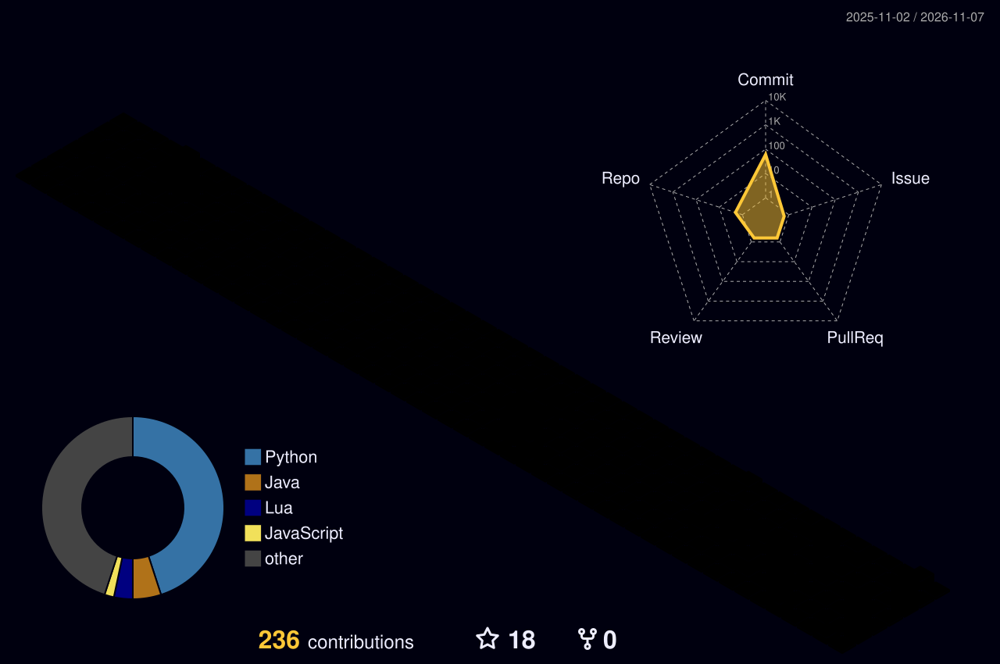

  

  
  
  
  

  Self-taught developer building desktop tools, Discord bots, game scripts and small simulators. 
  Mostly Python, with PHP and vanilla JavaScript on the web and Lua for game servers. 
  Portfolio and live projects: <a href="http://www.koki26.online/">koki26.online</a>

 

## Stack

   
  

 

## Selected work

  
  

  
  

 

## Activity

  
  

  

 

  

